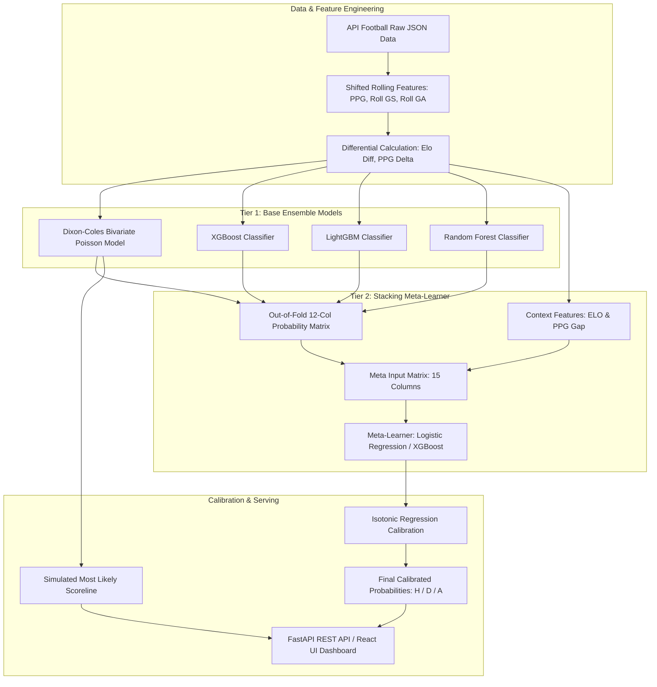

# 🏆 LaLiga Match Outcome Predictor & Stacking Ensemble Pipeline

[](https://laligaprediction.netlify.app/)
[](https://laligaprediction.onrender.com)
[](https://laligaprediction.onrender.com/docs)
[](https://python.org)
[](https://reactjs.org)
[](https://fastapi.tiangolo.com)
[](https://opensource.org/licenses/MIT)

A state-of-the-art football prediction system engineered with a multi-model stacking ensemble framework specifically optimized for **LaLiga**. The platform couples statistical goal-generation models with gradient-boosted decision trees and random forests to forecast match outcomes (Home Win, Draw, Away Win) and exact scorelines. The pipeline features strict temporal-safety barriers (zero data leakage), out-of-fold stacking, and isotonic probability calibration.

---

## 🔗 Live Demos & Documentation

* 🌐 **Live Web Application (Frontend)**: [https://laligaprediction.netlify.app/](https://laligaprediction.netlify.app/)
* ⚡ **Live API Service (Backend)**: [https://laligaprediction.onrender.com](https://laligaprediction.onrender.com)
* 📖 **Interactive API Documentation**: [https://laligaprediction.onrender.com/docs](https://laligaprediction.onrender.com/docs)

---

## 🎯 Problem It Solves
Predicting association football match outcomes is notoriously challenging due to:
- **Low-Scoring Dynamics & High Draw Variance**: Draws are frequent but hard to detect with standard classifiers.
- **Data Leakage in Feature Engineering**: Traditional pipelines inadvertently leak post-match stats into historical training data.
- **Overconfident Machine Learning Estimates**: Uncalibrated raw probabilities lead to skewed betting/analytic risks.

**This Project Solves These Issues By:**
- Implementing a **strict temporal walk-forward split** ensuring zero future-to-past data leakage.
- Combining parametric goal distributions (**Dixon-Coles Bivariate Poisson**) with tree-based ensembles (**XGBoost, LightGBM, Random Forest**).
- Applying **Isotonic Regression Calibration** on out-of-fold predictions to ensure output probabilities reflect empirical real-world success rates.

---

## 📊 Dataset Details

- **Dataset Name**: LaLiga Historical Fixtures & Performance Dataset (`matches-all-seasons.json`)
- **Data Sources**: [API-Football / RapidAPI](https://www.api-football.com/) & Historical ELO Rankings
- **Features Captured**:
  - Match details (Home Team, Away Team, Season, Date, Venue)
  - Historical goal stats (Goals Scored, Goals Conceded, Goal Differential)
  - ELO Ratings & ELO Differences ($\Delta\text{ELO}$)
  - Rolling 5-match form metrics (Points Per Game `PPG`, Goal Averages)
  - Squad status & player injury impact simulations

---

## 🛠️ Tech Stack

### **Machine Learning & Data Processing**
`Python 3.10+` | `scikit-learn` | `XGBoost` | `LightGBM` | `SciPy` | `pandas` | `NumPy` | `category-encoders`

### **Backend & Storage**
`FastAPI` | `Uvicorn` | `SQLAlchemy` | `SQLite` | `Pydantic` | `BeautifulSoup4`

### **Frontend & Visualization**
`React 18` | `TypeScript` | `Vite 5` | `Tailwind CSS` | `Shadcn UI` | `Recharts` | `Lucide React`

### **DevOps & Cloud**
`Docker` | `Docker Compose` | `Render` (Backend) | `Netlify` (Frontend)

---

## 🧠 Model & Algorithm Details

The architecture utilizes a **Two-Tier Stacking Ensemble (Stacked Generalization)**:



### Base Models:
1. **Dixon-Coles Bivariate Poisson**: Incorporates attack/defense parameters, home advantage ($\gamma$), time-decay weighting ($\tau$), and low-score draw correction ($\rho$).
2. **XGBoost & LightGBM**: Capture non-linear interactions between team ELO gaps, form differentials, and fatigue parameters.
3. **Random Forest**: Acts as a bagging-based stabilizing classifier with balanced sample weights.

### Stacking & Calibration:
- **Meta-Learner**: Benchmarks Logistic Regression vs XGBoost on 5-fold walk-forward validation splits, selecting the model with the lowest Ranked Probability Score (RPS).
- **Probability Calibration**: Calibrates logit outputs via Isotonic Regression on a 20% held-out chronological dataset.

---

## 📈 Model Performance & Benchmarks

Evaluated across walk-forward cross-validation folds on historical LaLiga records:

| Model / Architecture | Ranked Probability Score (RPS) ⬇️ | Log Loss ⬇️ | Macro F1-Score ⬆️ | Draw Recall ⬆️ |
|:---|:---:|:---:|:---:|:---:|
| **Random Forest Baseline** | 0.2185 | 1.1240 | 0.3840 | 0.1250 |
| **XGBoost Base Model** | 0.2110 | 1.0795 | 0.4167 | 0.1840 |
| **Stacking (XGB Meta)** | 0.2045 | 1.0540 | 0.4210 | 0.2010 |
| **Stacking Ensemble (LogReg Meta + Isotonic)** 🏆 | **0.1988** | **1.0312** | **0.4286** | **0.2179** |

---

## 📁 Project Structure

```
LaligaPrediction-project/
├── backend/
│   ├── api_football_fetcher.py      # RapidAPI / API-Football match data fetcher
│   ├── database.py                  # SQLite database engine & SQLAlchemy ORM models
│   ├── Dockerfile                   # Production Dockerfile for FastAPI (Render dynamic PORT)
│   ├── football_ensemble.py         # Stacking ensemble engine & walk-forward splits
│   ├── football_predictor_xgb.py    # Independent XGBoost/LightGBM model pipeline
│   ├── main.py                      # FastAPI App definition, health checks & endpoints
│   ├── player_data.py               # Player index & injury impact simulation
│   ├── poisson_model.py             # Dixon-Coles goal/score forecasting & parameter fitting
│   ├── predictor.py                 # PredictionEngine class tying models together
│   ├── requirements.txt             # Backend Python package dependencies
│   └── rf_model.py                  # Random Forest Classifier baseline
├── frontend/
│   ├── src/
│   │   ├── api/client.ts            # API Client configured with VITE_API_BASE_URL
│   │   ├── components/              # UI components (Dialog, Select, Progress, Card)
│   │   ├── App.tsx                  # React dashboard main view
│   │   └── index.css                # Tailwind CSS styling
│   ├── Dockerfile                   # Multi-stage Nginx build for Frontend
│   ├── netlify.toml                 # SPA redirect configuration for Netlify
│   ├── vercel.json                  # SPA rewrite configuration for Vercel
│   ├── package.json                 # Node package configuration
│   └── vite.config.ts               # Vite build configuration
├── src/
│   └── data/
│       └── matches-all-seasons.json # Canonical match dataset JSON repository
├── docker-compose.yml               # Multi-container orchestration
├── evaluate_pipeline.py             # Evaluation & benchmarking execution script
└── README.md                        # Master Project Documentation
```

---

## 💻 Installation & Setup

### Prerequisites
- **Python**: `3.10` or higher
- **Node.js**: `v18` or higher
- **Git** & **Docker** (optional)

### 1. Clone the Repository
```bash
git clone https://github.com/sayantan/LaligaPrediction-project.git
cd LaligaPrediction-project
```

### 2. Backend Setup
```bash
cd backend

# Create virtual environment
python -m venv venv
source venv/bin/activate  # On Windows: venv\Scripts\activate

# Install dependencies
pip install -r requirements.txt

# Start FastAPI dev server
python main.py
```
Backend API will be running at `http://localhost:8000`.

### 3. Frontend Setup
```bash
cd ../frontend

# Install dependencies
npm install

# Start Vite dev server
npm run dev
```
Frontend Dashboard will be running at `http://localhost:5173`.

---

## 🐳 Running with Docker

Run the entire application stack locally with Docker Compose:

```bash
docker-compose up --build -d
```

- **Frontend Dashboard**: `http://localhost:80`
- **Backend REST API**: `http://localhost:8000`

---

## 🚀 How to Run Evaluation & Benchmarking

To execute backtesting cross-validation sweeps on historical match data:

```bash
python evaluate_pipeline.py
```

Output metrics include Ranked Probability Score (RPS), Log Loss, Macro F1-score, and Draw Recall.

---

## 🔮 Future Improvements

- [ ] **Expected Goals (xG) Integration**: Incorporate shot-level xG metrics into feature engineering.
- [ ] **Automated Daily Retraining Pipeline**: Scheduled GitHub Action or cron job triggering `/api/refresh` daily.
- [ ] **Live Odds Value Bet Finder**: Compare model probability outputs against real-time bookmaker odds to compute expected value (+EV).
- [ ] **Player Tracking & Lineup Dynamics**: Integrate real-time starting 11 tactical formations.

---

## 👨‍💻 Author & Contribution

**Sayantan**
- **GitHub**: [@sayantan](https://github.com/sayantan)
- **Project Repository**: [LaligaPrediction-project](https://github.com/sayantan/LaligaPrediction-project)

Contributions, issues, and feature requests are welcome! Feel free to check out the [issues page](https://github.com/sayantan/LaligaPrediction-project/issues).

---

## 📄 License

This project is licensed under the **MIT License** - see the [LICENSE](LICENSE) file for details.
