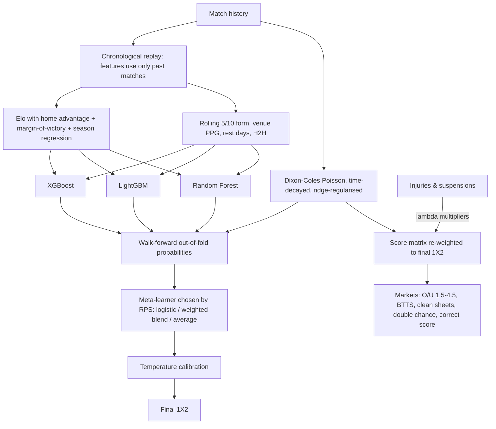

# 🏆 LaLiga Match Outcome Predictor & Stacking Ensemble Pipeline

[](https://laligaprediction.netlify.app/)
[](https://laligaprediction.onrender.com)
[](https://laligaprediction.onrender.com/docs)
[](https://python.org)
[](https://reactjs.org)
[](https://fastapi.tiangolo.com)

A state-of-the-art football prediction system engineered with a multi-model stacking ensemble framework specifically optimized for **LaLiga**. The platform couples statistical goal-generation models with gradient-boosted decision trees and random forests to forecast match outcomes (Home Win, Draw, Away Win) and exact scorelines. The pipeline features strict temporal-safety barriers (zero data leakage), out-of-fold stacking, and temperature-calibrated probabilities.

---

## 🔗 Live Demos & Documentation

* 🌐 **Live Web Application (Frontend)**: [https://laligaprediction.netlify.app/](https://laligaprediction.netlify.app/)
* ⚡ **Live API Service (Backend)**: [https://laligaprediction.onrender.com](https://laligaprediction.onrender.com)
* 📖 **Interactive API Documentation**: [https://laligaprediction.onrender.com/docs](https://laligaprediction.onrender.com/docs)

---

## 🎯 Problem It Solves
Predicting association football match outcomes is notoriously challenging due to:
- **Low-Scoring Dynamics & High Draw Variance**: Draws are frequent but hard to detect with standard classifiers.
- **Data Leakage in Feature Engineering**: Traditional pipelines inadvertently leak post-match stats into historical training data.
- **Overconfident Machine Learning Estimates**: Uncalibrated raw probabilities lead to skewed betting/analytic risks.

**This Project Solves These Issues By:**
- Implementing a **strict temporal walk-forward split** ensuring zero future-to-past data leakage.
- Combining parametric goal distributions (**Dixon-Coles Bivariate Poisson**) with tree-based ensembles (**XGBoost, LightGBM, Random Forest**).
- Selecting the meta-learner by walk-forward RPS and applying **temperature calibration** on out-of-sample predictions, so output probabilities reflect real-world frequencies.

---

## 📊 Dataset Details

- **Source**: [API-Football](https://www.api-football.com/) (LaLiga, league id 140). The free plan exposes seasons **2022/23–2024/25** and a ±1-day window for date queries.
- **Bundled snapshot** (`backend/data/snapshot/`, built by `scripts/build_snapshot.py`) so the app works offline and when the daily quota is used up:
  - `matches.json`: 1,140 finished matches with half-time scores, venue and referee
  - `players.json`: 463 players with season stats (goals, assists, rating, shots, key passes, dribbles, tackles, duels, cards…) and per-match logs for the final rounds
  - `injuries.json`: every missed-fixture record (injury type / suspension) for 422 players
  - `teams.json`, `standings.json`: crests, venues and the official table
- **Live data**: live scores and today/tomorrow fixtures come from API-Football through a SQLite cache with per-resource TTLs and a daily request budget (`DAILY_REQUEST_BUDGET`, default 90 of the plan's 100).

---

## 🛠️ Tech Stack

### **Machine Learning & Data Processing**
`Python 3.12` | `scikit-learn` | `XGBoost` | `LightGBM` | `SciPy` | `pandas` | `NumPy` | `joblib`

### **Backend & Storage**
`FastAPI` | `Uvicorn` | `SQLAlchemy` | `SQLite` | `Pydantic` | `httpx`

### **Frontend & Visualization**
`React 18` | `TypeScript` | `Vite 5` | `Tailwind CSS` | `shadcn/ui` | `TanStack Query` | `Recharts` | `next-themes`

### **DevOps & Cloud**
`Docker` | `Docker Compose` | `Render` (Backend) | `Netlify` (Frontend)

---

## 🧠 Model & Algorithm Details



- **Dixon-Coles Poisson**: attack/defence strengths, home advantage, low-score correction (ρ) and exponential time decay (half-life chosen by a walk-forward RPS sweep). Fitted with L-BFGS-B and an analytic gradient.
- **Tree models**: XGBoost, LightGBM and Random Forest on a single feature builder shared by training and inference, so there is no train/serve skew and no leakage.
- **Stacking**: base models produce walk-forward out-of-fold probabilities. Logistic regression, a convex weighted blend and a plain average compete on a second walk-forward pass, and the lowest RPS wins. A temperature is then fitted for calibration.
- **Consistent markets**: the Poisson score matrix is re-weighted so its home/draw/away mass equals the ensemble's. Every goal market and correct score is therefore consistent with the headline probabilities.
- **Availability**: unavailable players reduce their team's expected goals by their share of goal contributions and minutes (capped at −15%). Missing goalkeepers and defenders raise the opponent's expected goals (up to +10%).

---

## 📈 Model Performance & Benchmarks

Walk-forward, out-of-sample evaluation on the last 307 matches of the data set (reproduce with `python -m app.ml.train --sweep`; the live numbers are on the **Model Lab** page):

| Model | Accuracy ⬆️ | RPS ⬇️ | Log loss ⬇️ | Brier ⬇️ |
|:---|:---:|:---:|:---:|:---:|
| Baseline (class frequency) | 44.0% | 0.2306 | 1.0747 | 0.6500 |
| XGBoost | 49.8% | 0.2072 | 1.0144 | 0.6054 |
| LightGBM | 49.2% | 0.2101 | 1.0284 | 0.6138 |
| Random Forest | 50.2% | 0.2062 | 1.0082 | 0.6016 |
| Dixon-Coles Poisson | 51.8% | 0.2001 | 0.9836 | 0.5839 |
| **Stacked ensemble (weighted blend)** | 51.1% | 0.2003 | 0.9852 | 0.5849 |

The ensemble matches the strongest single model and is better calibrated in high-confidence buckets: 84% hit rate when confidence is ≥65%.

---

## 🎯 Features

- **Dashboard**: KPIs, live/upcoming fixtures with model picks, league table, top performers, availability summary, power rankings and in-form teams.
- **Match predictor**: 1X2, most likely score, xG, model agreement, "why this prediction" factors, goal markets (O/U 1.5/2.5/3.5/4.5, BTTS, clean sheets, double chance, draw no bet) with fair odds, a scoreline heatmap, the top-10 correct scores, winning margins, the per-model breakdown, form & H2H, and injury-adjusted xG.
- **Matches**: live scores (auto-refresh while a match is in progress), upcoming fixtures with predictions, results.
- **Standings & power rankings**: zone-coloured table plus Elo / attack / defence ratings.
- **Team analysis**: season record, goal trend, Elo history, home vs away, goals by half, last 10, squad, unavailable players and a head-to-head explorer.
- **Players**: sortable and filterable stats table and leaderboards. Each profile has per-90 percentiles vs position peers, recent match ratings and efficiency metrics.
- **Player comparison**: percentile radar plus a per-90 head-to-head table, shareable via URL.
- **Injury tracker**: status (Out / Suspended / Doubtful), injury type, time out, estimated return and the impact on team xG.
- **Model lab**: backtest leaderboard, calibration curve, feature importance, accuracy by confidence and prediction history.
- Dark/light themes, ⌘K global search, responsive layout with mobile navigation, cold-start banner.

### API (`/api`, interactive docs at `/docs`)
`GET /health` · `GET /teams` · `POST /predict` · `GET /teams/{team}/analysis` · `GET /h2h` · `GET /standings` · `GET /power-rankings` · `GET /players` · `GET /players/leaders` · `GET /players/{id}` · `GET /players/compare` · `GET /injuries` · `GET /fixtures/live` · `GET /fixtures/upcoming` · `GET /fixtures/results` · `GET /fixtures/simulate-round` · `GET /model/metrics` · `GET /history` · `POST /refresh`

---

## 📁 Project Structure

```
LaligaPrediction-project/
├── backend/
│   ├── main.py                  # uvicorn entry point (re-exports app.main:app)
│   ├── app/
│   │   ├── main.py              # FastAPI app, CORS, gzip, lifespan
│   │   ├── config.py · db.py    # settings, SQLite models (history, API cache, quota)
│   │   ├── ml/                  # poisson.py, elo.py, features.py, ensemble.py, train.py, registry.py
│   │   ├── services/            # data_store, football_api (cache+quota), fixtures, team_stats,
│   │   │                        # player_stats, injuries, prediction
│   │   └── routers/             # predict, teams, players, matches, system
│   ├── data/snapshot/           # bundled data (committed)
│   ├── models/                  # trained ensemble.joblib + metrics.json
│   ├── scripts/build_snapshot.py
│   ├── tests/                   # pytest suite
│   └── requirements.txt
├── frontend/
│   └── src/
│       ├── api/                 # typed client + response types
│       ├── hooks/queries.ts     # TanStack Query hooks
│       ├── components/          # layout, common, charts, predict, matches, ui (shadcn)
│       └── pages/               # Dashboard, Predictor, Matches, Standings, Teams, TeamDetail,
│                                # Players, PlayerDetail, Compare, Injuries, ModelLab
└── docker-compose.yml
```

---

## 💻 Installation & Setup

### Prerequisites
- **Python** 3.11+ (3.12 recommended), **Node.js** 18+

### 1. Clone the Repository
```bash
git clone https://github.com/SayantanSheet/LaligaPrediction.git
cd LaligaPrediction
```

### 2. Backend Setup
```bash
cd backend
python -m venv .venv && source .venv/bin/activate   # Windows: .venv\Scripts\activate
pip install -r requirements-dev.txt
cp .env.example .env                                 # add your API_FOOTBALL_KEY (optional for offline use)

python -m app.ml.train --sweep    # optional: retrain (the repo ships a trained model)
uvicorn main:app --reload         # http://localhost:8000  (docs at /docs)
pytest                            # run the test suite
```

Refresh the data snapshot (resumable, respects the 100 requests/day and 10 requests/min limits):
```bash
python -m scripts.build_snapshot --fetch --player-logs 3
python -m app.ml.train --sweep
```

### 3. Frontend Setup
```bash
cd ../frontend
npm install
npm run dev        # http://localhost:8080  (set VITE_API_BASE_URL to point at another API)
```

Run the backend and frontend in two terminals, then open **http://localhost:8080**.

---

## 🔑 API-Football Key

The key is **optional**: the repo ships a trained model and a data snapshot, so the app works fully offline. A key is only needed for live scores and today's fixtures.

1. Sign up / log in at [dashboard.api-football.com](https://dashboard.api-football.com) (the free plan is enough).
2. Open **Account → My Access** and copy your **API Key**.
3. Add it to `backend/.env` (copied from `.env.example`):
   ```bash
   API_FOOTBALL_KEY=your_key_here
   ```
   `.env` is a hidden file: use `ls -a`, or **Ctrl+H** in a Linux file manager / **Cmd+Shift+.** in macOS Finder to see it. It is git-ignored, so never commit it.
4. Restart the backend. `GET /api/health` reports `"configured": true` under `api_quota` once the key is picked up.

For Docker, `export API_FOOTBALL_KEY=your_key_here` before `docker compose up`. On Render, add it under **Environment** in the backend service.

---

## 🐳 Running with Docker

Run the entire application stack locally with Docker Compose:

```bash
docker compose up --build -d
```

- **Frontend Dashboard**: `http://localhost:80`
- **Backend REST API**: `http://localhost:8000` (docs at `/docs`)

The backend image retrains the model during the build, so the first build takes a few minutes. Stop everything with `docker compose down`.

---

## 🩺 Troubleshooting

- **Live scores / today's fixtures are empty**: no API key, no internet access, or the daily budget is spent (check `api_quota` in `GET /api/health`). Everything else keeps working from the snapshot.
- **`pip install` fails building numpy / xgboost / lightgbm**: use Python 3.12 (`python3.12 -m venv .venv`).
- **Frontend shows a connection error**: make sure the backend is running on port 8000, or set `VITE_API_BASE_URL`.
